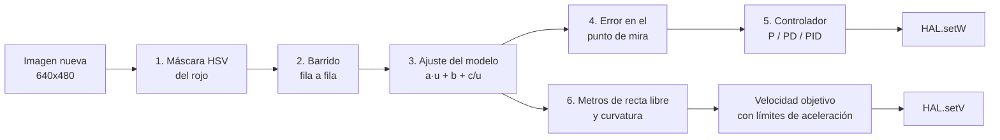
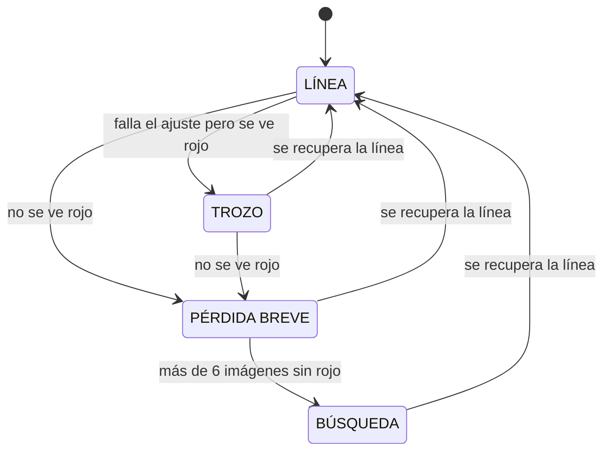

# Follow Line: control visual reactivo P, PD y PID

Solución al ejercicio [**Visual Follow Line**](https://jderobot.github.io/RoboticsAcademy/exercises/AutonomousCars/follow_line/) de JdeRobot Robotics Academy (plataforma **Unibotics**). Un Fórmula 1 simulado en Gazebo tiene que seguir la línea roja pintada en el centro del circuito **Simple Circuit** usando solo la imagen de su cámara frontal, y hacerlo lo más rápido posible.

Hay tres versiones del controlador. Comparten la percepción, el cálculo del error y el control de velocidad. Lo único que cambia es la ley de control del volante (y la puesta a punto de algunos parámetros):

| Versión | Fichero | Control del volante |
|---|---|---|
| **P** | `versionP.py` | W = K<sub>P</sub>·e |
| **PD** | `versionPD.py` | W = K<sub>P</sub>·e + K<sub>D</sub>·de/dt |
| **PID** | `versionPID.py` | W = K<sub>P</sub>·e + K<sub>I</sub>·∫e dt + K<sub>D</sub>·de/dt (con anti-windup) |

---

## Índice

1. [Estructura del repositorio](#estructura-del-repositorio)
2. [Instrucciones de uso](#instrucciones-de-uso)
3. [Cómo funciona](#cómo-funciona)
4. [Parámetros de cada versión](#parámetros-de-cada-versión)
5. [Resultados](#resultados)
6. [Análisis del rendimiento](#análisis-del-rendimiento)
7. [Ajuste y posibles mejoras](#ajuste-y-posibles-mejoras)

---

## Estructura del repositorio

```
.
├── README.md
├── versionP.py        # controlador P
├── versionPD.py       # controlador PD
├── versionPID.py      # controlador PID
└── img/
    ├── tiempo_P.png   # captura: circuito + tiempo de 2 vueltas (P)
    ├── tiempo_PD.png  # captura: circuito + tiempo de 2 vueltas (PD)
    └── tiempo_PID.png # captura: circuito + tiempo de 2 vueltas (PID)
```

---

## Instrucciones de uso

### Requisitos

- Acceso al ejercicio **Follow Line** en [Unibotics](https://unibotics.org), o una instalación local de Robotics Academy con Docker (ver la [documentación del ejercicio](https://jderobot.github.io/RoboticsAcademy/exercises/AutonomousCars/follow_line/)).
- No hay que instalar nada. Los módulos `HAL`, `Frequency` y `WebGUI` los proporciona la propia plataforma, y OpenCV y NumPy ya vienen en el entorno del ejercicio. Por eso los scripts no se pueden ejecutar fuera de él.

### Ejecución

1. Abrir el ejercicio **Follow Line** y seleccionar el circuito **Simple Circuit**.
2. Copiar el contenido completo de uno de los scripts (`versionP.py`, `versionPD.py` o `versionPID.py`) en el editor del ejercicio.
3. Pulsar el botón de ejecución (▶). El coche arranca a 2 m/s y acelera solo según lo que ve delante.
4. En el visor aparece la imagen de la cámara del coche. El tiempo de vuelta se lee en el contador de tiempo del ejercicio.
5. Antes de probar otra versión, detener el código y **reiniciar la simulación** para que el coche vuelva a la línea de salida y las tres versiones se midan en las mismas condiciones.

Todos los parámetros están agrupados al principio de cada fichero, en la sección `PARAMETROS`, para poder ajustarlos sin tocar la lógica (ver [Ajuste y posibles mejoras](#ajuste-y-posibles-mejoras)).

---

## Cómo funciona

El bucle principal funciona a 60 Hz, pero la cámara solo da 20 imágenes por segundo, así que la cadena de procesamiento completa se ejecuta **una vez por cada imagen nueva**:



### Geometría de la cámara

Todo el sistema se apoya en la geometría real de la cámara del F1, sacada del modelo de Gazebo:

| Dato | Valor |
|---|---|
| Resolución | 640 × 480 px |
| Campo de visión horizontal | 1.57 rad (90°) → distancia focal f ≈ 320 px |
| Altura sobre el suelo (H) | 0.109 m |
| Posición | 0.45 m por delante y 0.04 m a la izquierda del centro del coche |
| Inclinación | ninguna → el horizonte está en la mitad de la imagen (fila ≈ 239.5) |
| Alcance | ~15 m |
| Anchura real de la línea | 0.12 m |

Con una cámara horizontal (modelo *pinhole*), un punto del suelo a una distancia Z por delante y desplazado X a la izquierda aparece en:

```math
u = y - y_h = \frac{f\,H}{Z} \qquad\qquad c_x - x = \frac{f\,X}{Z}
```

donde *y<sub>h</sub>* es la fila del horizonte y *c<sub>x</sub>* la columna central. De aquí salen tres relaciones que se usan en todo el código:

- **Distancia de cada fila:** Z = f·H / u. Cada fila de la imagen corresponde a una distancia concreta en el suelo.
- **Anchura esperada de la línea en píxeles:** 0.12 · u / H. Crece linealmente al bajar en la imagen.
- **Desplazamiento lateral en metros** de un desvío de Δx píxeles: ΔX = Δx · H / u.

### 1. Percepción: máscara del rojo

- La imagen se pasa de BGR a **HSV**. En HSV el tono (H) apenas cambia con las sombras, que solo afectan al brillo (V), así que la detección es más robusta que en RGB.
- El rojo está en los **dos extremos** del tono en OpenCV (0–10 y 165–179), por eso se usan dos rangos que luego se unen.
- Limpieza morfológica: una **apertura** 3×3 elimina el ruido suelto y un **cierre** 5×5 rellena huecos dentro de la línea.
- Solo se procesa la franja entre el horizonte y el 70 % de la altura. Por encima no hay suelo, y por debajo aparece el morro del coche. Esto además ahorra tiempo de cómputo.

### 2. Barrido de la línea fila a fila

En lugar de calcular un único centroide, se recorre la imagen **de abajo arriba** y se localiza la línea en 44 filas, desde ~0.36 m hasta ~14 m por delante de la cámara:

- **Paso variable:** la separación entre filas es el 6 % de la distancia al horizonte (entre 1 y 5 px). Cerca del coche se saltan filas, y cerca del horizonte, donde un solo píxel abarca varios metros de suelo, se analiza cada fila.
- En cada fila se buscan los **tramos rojos continuos** (de al menos 2 px de ancho).
- **Seguimiento por continuidad:** se elige el tramo más cercano a una predicción lineal (posición del punto anterior + pendiente que lleva la línea). En la primera fila se parte de donde empezaba la línea en la imagen anterior; si no hay historia, se elige el tramo más ancho.
- Un tramo que se aleja de la predicción más de max(30 px, ½ anchura esperada) se descarta. La tolerancia crece con cada fila fallida, y tras 5 filas seguidas sin línea se deja de subir.
- Si un tramo es más de 3 veces más ancho de lo esperado, la línea va casi horizontal (curva muy cerrada) y el barrido se detiene ahí.
- Se marca cada punto que toca el borde de la imagen, porque su centro está sesgado (parte de la línea queda fuera).

### 3. Modelo de la línea

Cerca del coche, la línea se describe como un desplazamiento lateral *d*, un ángulo *ψ* y una curvatura *κ*. Sustituyendo en las ecuaciones de la cámara, la columna de la línea en función de la fila queda:

```math
X(Z) = d + \psi Z + \tfrac{1}{2}\kappa Z^2
\;\;\Longrightarrow\;\;
c_x - x = \underbrace{\frac{d}{H}}_{\text{desplazamiento}}\,u
\;+\; \underbrace{f\,\psi}_{\text{orientación}}
\;+\; \underbrace{\frac{f^2 H\,\kappa}{2}}_{\text{curvatura}}\,\frac{1}{u}
```

Es decir, en coordenadas normalizadas **x<sub>n</sub> = a·u + b + c/u**: el término proporcional a *u* es el desplazamiento, el constante es la orientación y el que va en 1/*u* es la curvatura. Un ajuste por **mínimos cuadrados** sobre decenas de puntos separa las tres cosas y promedia el ruido de cada fila:

- Solo se usan los puntos cercanos (por debajo del 56 % de la altura, hasta ~1.2 m), donde la resolución es mejor y el modelo es válido. Se descartan los puntos cortados por el borde.
- La curvatura solo se estima si hay al menos 8 puntos y suficiente separación entre filas. Si no, se ajusta solo desplazamiento y ángulo.
- **Regularización:** se añade una ecuación que empuja *c* hacia el valor de la imagen anterior. Cuando los puntos no bastan para fijar la curvatura, el modelo no se la inventa.
- **Segunda pasada sin outliers:** se repite el ajuste sin los puntos con residuo mayor de 4 px (brillos, otro trozo de línea, etc.).
- La curvatura real se obtiene como κ = c · w · h / (f² · H), en 1/m.

### 4. Error: ángulo hacia un punto de mira

El error no se mide en una fila fija, sino en un **punto de la línea situado L metros por delante**, y L crece con la velocidad (la misma idea que el *pure pursuit*):

```math
L = \operatorname{clip}\left(V \cdot T_{look},\; L_{min},\; L_{max}\right)
\qquad
y_{look} = y_h + \frac{f\,H}{L}
\qquad
e = \frac{x_{eje}(y_{look}) - x_{linea}(y_{look})}{w/2}
```

- En recta y a alta velocidad se mira lejos (hasta 10–12 m), lo que hace el control estable aunque haya retardo (la cámara solo da 20 imágenes/s). En las curvas, más lentas, se mira cerca (mínimo 1 m) y el seguimiento es más preciso.
- La columna de la línea en esa fila se **interpola** entre los puntos del barrido. Si la línea no llega tan lejos (por ejemplo, porque una curva la saca de la imagen), se usa el punto visible más lejano, que queda hacia el interior de la curva.
- **Corrección del descentrado de la cámara:** como la cámara está 4 cm a la izquierda del eje del coche, el eje se proyecta en x<sub>eje</sub> = c<sub>x</sub> + 0.04 · u / H, algo a la derecha del centro de la imagen. Sin esta corrección el coche circularía desplazado 4 cm respecto a la línea.
- Como el campo de visión es de 90°, w/2 ≈ f, y el error normalizado es prácticamente la **tangente del ángulo** con el que se ve el punto de mira.
- **Convenio de signos:** e > 0 → línea a la izquierda → W > 0 (giro a la izquierda).

### 5. Control del volante

La salida del controlador es la velocidad angular W, saturada a ±6 rad/s.

#### P: `versionP.py`

```math
W = K_P \, e
```

Gira más cuanto más lejos está la línea del eje del coche. No tiene memoria: solo usa el error de la imagen actual. Es el más simple, pero no tiene ningún mecanismo que amortigüe las oscilaciones.

#### PD: `versionPD.py`

```math
W = K_P \, e + K_D \, \dot e_f
\qquad
\dot e_f[k] = \alpha\,\frac{e[k]-e[k-1]}{\Delta t} + (1-\alpha)\,\dot e_f[k-1]
```

- El término **D** mide lo rápido que cambia el error. Si el coche se acerca deprisa a la línea, de/dt tiene signo contrario a *e* y "afloja" el giro antes de pasarse, lo que **amortigua las oscilaciones** del P.
- La derivada se calcula restando el error de dos imágenes consecutivas. Como eso amplifica el ruido, se suaviza con un filtro paso bajo de primer orden (α = 0.8).

#### PID: `versionPID.py`

```math
W = K_P \, e + K_I \int e\,dt + K_D \, \dot e_f
```

El término **I** acumula el error en el tiempo para corregir errores constantes (un coche que tira hacia un lado, una cámara algo torcida). Para que la integral no "se cargue" y saque al coche al salir de las curvas, lleva **tres mecanismos anti-windup**:

1. **Tope de la integral:** el error acumulado nunca pasa de ±0.15.
2. **Integración condicional:** si el volante ya está al tope (±6 rad/s) y el error empuja hacia el mismo lado, no se acumula más.
3. **Separación de la integral (*I-zone*):** solo se integra cuando |e| < 0.05. Como el error se mide por delante del coche, en una curva siempre hay algo de error aunque el coche vaya bien; si la integral lo acumulase, lo arrastraría a la recta siguiente. Así la integral queda "congelada" en las curvas y solo corrige en las rectas.

En PD y PID el estado del controlador (error anterior, derivada filtrada e integral) se reinicia cada vez que se pierde la línea, porque el error pasa a venir de otra fuente.

### 6. Control de velocidad "por tramos"

La velocidad se decide según **cuántos metros de recta se ven por delante**:

1. **Metros de recta libre (z<sub>libre</sub>):** se prolonga la recta que forma la línea cerca del coche (solo desplazamiento y ángulo del ajuste, sin curvatura) y se recorren los puntos del barrido de cerca a lejos. El primer punto que se aparta más de **0.5 m** de esa recta marca el inicio de la curva. Si la línea se ve recta hasta el horizonte, z<sub>libre</sub> = 15 m (el alcance de la cámara). Si desaparece antes, z<sub>libre</sub> es el último punto recto.
2. **Frenar a tiempo:** se va a la velocidad desde la que se puede frenar hasta V<sub>curva</sub> en esa distancia (menos un margen de 2 m), suponiendo una deceleración a<sub>fren</sub>.
3. **Dentro de la curva:** se limita la aceleración lateral, v²·κ ≤ a<sub>lat</sub>.

```math
V_{obj} = \min\left(
\sqrt{V_{curva}^2 + 2\,a_{fren}\,\max\left(0,\; z_{libre} - z_{margen}\right)}
\;,\;\;
\sqrt{\frac{a_{lat}}{\kappa}}
\right)
```

4. Por último, V<sub>obj</sub> se limita entre 2.5 y 40 m/s, y la velocidad enviada al coche se acerca a ella con un límite de **+40 m/s²** al acelerar y **−80 m/s²** al frenar, para evitar tirones.

El resultado es un perfil de velocidad por tramos: acelerar a fondo en recta, frenar de forma progresiva cuando aparece una curva al fondo de la imagen, pasar la curva a velocidad controlada y volver a acelerar al salir. La deceleración que se supone al planificar (40–50 m/s²) es menor que la que el coche puede hacer de verdad (80 m/s²). Esto da margen, porque al fondo de la imagen un píxel abarca varios metros y la curva se detecta con poca precisión.

### 7. Modos de funcionamiento y recuperación



| Modo | Cuándo | Velocidad | Volante |
|---|---|---|---|
| **LÍNEA** | El barrido y el ajuste funcionan | Perfil "por tramos" | Controlador P / PD / PID |
| **TROZO** | No hay ajuste, pero hay alguna mancha roja (≥ 40 px) | 2 m/s | P simple (K<sub>P</sub> = 1.5) hacia el centroide de la mancha más fiable |
| **PÉRDIDA BREVE** | Hasta 6 imágenes seguidas sin ver rojo | Baja hasta ≤ 2 m/s | Mantiene el último giro |
| **BÚSQUEDA** | Más de 6 imágenes sin ver rojo | 0.5 m/s | ±1.2 rad/s hacia el último lado donde se vio la línea |

En el modo TROZO se buscan componentes conexas en la máscara. Se descartan las que tienen menos del 30 % del área de la mayor y se elige la más cercana a la mancha seguida en la imagen anterior.

### Sincronización con la cámara

- El bucle va a 60 Hz y la cámara a 20 imágenes/s. Para no procesar la misma imagen varias veces, se guarda una "firma" (un píxel de cada 40 en filas y columnas) y se compara con la anterior. Si coincide, se salta la iteración.
- El intervalo de tiempo Δt se mide con el reloj real entre imágenes procesadas (limitado entre 1 ms y 0.25 s). Así la derivada y la integral usan el tiempo correcto. Si se procesara dos veces la misma imagen, la derivada valdría cero en una iteración y daría un pico en la siguiente.

---

## Parámetros de cada versión

Parámetros que **cambian** entre versiones:

| Parámetro | P | PD | PID | Significado |
|---|:---:|:---:|:---:|---|
| `KP` | 5.0 | 6.0 | 6.0 | Ganancia proporcional |
| `KD` | – | 0.6 | 0.6 | Ganancia derivativa |
| `D_ALPHA` | – | 0.8 | 0.8 | Filtro paso bajo de la derivada (1 = sin filtrar) |
| `KI` | – | – | 1.0 | Ganancia integral |
| `I_LIMIT` | – | – | 0.15 | Tope de la integral |
| `I_ZONE` | – | – | 0.05 | Solo se integra si \|e\| < I_ZONE |
| `LOOKAHEAD_TIME` | 0.4 s | 0.3 s | 0.3 s | L = V · LOOKAHEAD_TIME |
| `LOOKAHEAD_MAX` | 12 m | 10 m | 10 m | Distancia de mira máxima |
| `V_CURVE` | 11 m/s | 17 m/s | 17 m/s | Velocidad de llegada a una curva |
| `A_LAT` | 35 m/s² | 80 m/s² | 80 m/s² | Aceleración lateral máxima en curva |
| `BRAKE_PLAN` | 40 m/s² | 50 m/s² | 50 m/s² | Deceleración supuesta al planificar |

Parámetros **comunes** a las tres:

| Parámetro | Valor | Significado |
|---|:---:|---|
| `V_MAX` / `V_MIN` | 40 / 2.5 m/s | Límites de velocidad siguiendo la línea |
| `ACCEL` / `DECEL` | 40 / 80 m/s² | Límites de aceleración y frenada |
| `LAT_TOL` | 0.5 m | Desvío respecto a la recta a partir del cual empieza una curva |
| `Z_MARGIN` | 2 m | Margen de seguridad antes de la curva |
| `LOOKAHEAD_MIN` | 1 m | Distancia de mira mínima |
| `W_MAX` | 6 rad/s | Saturación del volante |
| `CAM_FAR` | 15 m | Alcance de la cámara |

---

## Resultados

Pruebas en **Simple Circuit**, midiendo el tiempo en completar **2 vueltas** con cada versión. Todas parten de la posición inicial tras reiniciar la simulación.

En cada captura se ve, arriba, el mapa del circuito con el tiempo total en rojo (esquina superior derecha) y, debajo, la vista de Gazebo con el F1 sobre la línea roja al terminar las 2 vueltas.

### Versión P


**Tiempo (2 vueltas): 131.70 s**

### Versión PD


**Tiempo (2 vueltas): 111.53 s**

### Versión PID


**Tiempo (2 vueltas): 105.14 s**

### Resumen

| Versión | Tiempo (2 vueltas) | Diferencia con P | Diferencia con la versión anterior |
|---|:---:|:---:|:---:|
| P | 131.70 s | – | – |
| PD | 111.53 s | −20.17 s (−15.3 %) | −20.17 s (−15.3 %) respecto a P |
| **PID** | **105.14 s** | **−26.56 s (−20.2 %)** | −6.39 s (−5.7 %) respecto a PD |

---

## Análisis del rendimiento

### Límites teóricos de cada configuración

A partir de las fórmulas del control de velocidad se pueden calcular las velocidades máximas que permite cada configuración:

| | P | PD / PID |
|---|:---:|:---:|
| Velocidad máxima en recta (z<sub>libre</sub> = 15 m) | **34.1 m/s** | **39.9 m/s** |
| Distancia de mira a esa velocidad | 12 m | 10 m |
| Velocidad límite en una curva de R = 10 m | 18.7 m/s | 28.3 m/s |
| Velocidad límite en una curva de R = 5 m | 13.2 m/s | 20.0 m/s |

Aunque `V_MAX` = 40 m/s en las tres versiones, la velocidad punta real la marca **lo que se ve por delante**: el coche solo va tan rápido como le permita frenar a tiempo dentro de los ~15 m que alcanza la cámara. Con los parámetros del P, ese límite queda en ~34 m/s. Con los del PD/PID, casi en los 40 m/s.

### Comparación entre controladores

- **P (131.70 s):** sin término derivativo, nada frena las oscilaciones. Para que no haga zigzag a alta velocidad necesita mirar más lejos (0.4 s, hasta 12 m), lo que lo hace más estable pero menos preciso en las curvas, y un perfil de velocidad más conservador (V<sub>curva</sub> = 11 m/s, a<sub>lat</sub> = 35 m/s²). Es el más sencillo, pero el que menos velocidad admite, y por eso es el más lento.
- **PD (111.53 s, un 15.3 % más rápido que el P):** el término D amortigua las oscilaciones. Eso permite una ganancia proporcional más alta, un punto de mira más cercano (0.3 s, hasta 10 m) y un perfil de velocidad mucho más agresivo: entra en las curvas a 17 m/s en lugar de 11 y admite más del doble de aceleración lateral. La mayor parte de la mejora respecto al P viene de aquí: el coche puede ir más rápido en curva y alcanzar casi los 40 m/s en recta sin perder la línea.
- **PID (105.14 s, un 5.7 % más rápido que el PD):** el PD y el PID usan exactamente los mismos parámetros de velocidad y de punto de mira, así que los 6.39 s de diferencia se deben solo al término integral. Gracias a la separación de la integral, la I queda congelada en las curvas (no estropea el paso por curva) y actúa en las rectas. Ahí corrige los pequeños desvíos residuales que el P y la D no eliminan del todo, de modo que el coche sale de cada curva mejor centrado y alineado con la línea. Con el coche bien alineado, la línea se ve recta durante más metros, z<sub>libre</sub> es mayor y el control de velocidad permite acelerar antes y llegar más rápido a la siguiente curva.

> **Conclusión:** la versión más rápida fue la **PID**, con **105.14 s** en 2 vueltas. Es un 20.2 % más rápida que el P (−26.56 s) y un 5.7 % más rápida que el PD (−6.39 s). El salto más grande lo da el término derivativo, que estabiliza el control lo suficiente para usar un perfil de velocidad mucho más agresivo. El término integral, protegido con anti-windup, aporta una mejora adicional menor pero clara.

---

## Ajuste y posibles mejoras

### Guía rápida de ajuste

| Síntoma | Qué cambiar |
|---|---|
| Se sale en las curvas | Bajar `V_CURVE`, `A_LAT` o `BRAKE_PLAN`; subir `Z_MARGIN` |
| Hace zigzag en las rectas | Subir `LOOKAHEAD_TIME` o `LOOKAHEAD_MAX`; en PD/PID subir `KD`; bajar `KP` |
| Corta las curvas o reacciona tarde | Bajar `LOOKAHEAD_TIME` o `LOOKAHEAD_MAX`; subir `KP` |
| Frena demasiado pronto | Subir `BRAKE_PLAN` o `LAT_TOL`; bajar `Z_MARGIN` |
| Pierde la línea con sombras o brillos | Ajustar `RED_RANGES` (saturación y brillo mínimos) |

### Posibles mejoras

- **Feedforward de curvatura:** añadir W = V·κ a la salida del controlador. Así el PID solo tendría que corregir la desviación y no "perseguir" la curva, y la integral podría actuar también en las curvas.
- **Planificación con la curvatura lejana:** estimar el radio de cada curva antes de llegar a ella, en lugar de usar un único V<sub>curva</sub> para todas.
- **Ganancias dependientes de la velocidad** (*gain scheduling*): ganancias más bajas en recta a alta velocidad y más altas en curvas lentas.
